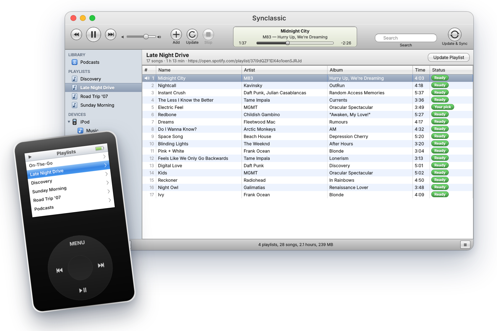

# Synclassic

<p align="center"></p>


Synclassic reads your playlists (Spotify links, your Spotify account, `.m3u8` files or CSV
exports), finds each song on YouTube Music, downloads it as a tagged **M4A** (or MP3) file
with full-size album art, and syncs it all to an iPod 5th/5.5th generation (Video), the way
iTunes did. Run it again and it only downloads and copies what's new.

## Install on a Mac

You need [Homebrew](https://brew.sh). Then in Terminal:

```bash
brew install python@3.12 ffmpeg deno
```

```bash
git clone https://github.com/kerthmfy/synclassic.git
cd synclassic
python3.12 -m venv .venv
source .venv/bin/activate
pip install -e .
```

```bash
synclassic doctor
```

Open the app:

```bash
synclassic-gui
```

Or make a double-clickable **Synclassic.app** (in `~/Applications`, with its own icon; open it
from Finder or Spotlight and drag it to your Dock):

```bash
synclassic install-app
```

The app runs the Synclassic installed in this folder, so `git pull` updates it too. Run
`install-app` again if you move the folder or recreate `.venv`. Problems are logged to
`~/Library/Logs/Synclassic.log`.

`ffmpeg` converts and repackages audio (and its `ffplay` plays previews). `deno` is needed
by the YouTube downloader. Next time, open Terminal, `cd synclassic`, and run
`source .venv/bin/activate` before using `synclassic` or `synclassic-gui`.

## The app

- **＋ Add playlists**: paste a Spotify link, tick playlists from your Spotify account
  (including Liked Songs), or import an `.m3u8` / `.csv` file.
- **Update & Sync** (top right, or on the iPod page): checks Spotify, downloads what's new,
  then syncs your iPod. If the sync only adds songs and playlists it goes straight through;
  removals and playlist take-overs are shown first for you to confirm.
- **⟳ Update**: checks every playlist for changes and downloads what's new. **■ Stop**
  pauses after the current song; updating again continues where it left off.
- **Needs attention**: songs that weren't found or might be the wrong version.
  Double-click a song to see the closest YouTube Music results, **play a preview**, search
  with your own words or paste a link, then **Download this version**.
- **Play music**: double-click a song (in your playlists or on the iPod) and the list plays from
  there. ⏮ ▶ ⏭ and volume are top left; the LCD shows the song with a bar you can drag to seek;
  the cover shows under the source list. Shuffle and repeat are in the bottom bar. Space plays
  and pauses; ⌘→ / ⌘← skip. Songs you listen to past half way (or 4 minutes) are scrobbled to
  Last.fm too.
- Right-click a song or playlist for more (search again, show in Finder, rename, remove).
- **Settings**: music folder, M4A/MP3, YouTube sign-in browser, and the Spotify login.

Everything below also works from Terminal with the `synclassic` command.

## Add playlists

Any of these work, and you can mix them in one command:

```bash
synclassic add https://open.spotify.com/playlist/XXXXXXXXXXXXXXXXXXXXXX
```

```bash
synclassic add liked
```

```bash
synclassic add "~/Downloads/Road Trip.m3u8" ~/Downloads/export.csv
```

| Input | Login needed? | Notes |
| --- | --- | --- |
| Spotify playlist / album / track link | No | Playlists over 100 songs are read in full by the full-playlist reader (below). |
| `liked` (your Liked Songs) | Yes | |
| Your own playlists, any length | Yes | `synclassic add --all-mine` adds Liked Songs plus every playlist you own. |
| `.m3u8` / `.m3u` file | No | Songs that already exist on your Mac are used as-is; others are downloaded. |
| `.csv` export (Exportify, TuneMyMusic) | No | A file with several playlists becomes several playlists. |

## Find Music (songs and albums)

Not everything is in a playlist: click **Find Music** (under LIBRARY), search for a song, album
or artist, and **Get** a song or **Get Album**. Results come from Deezer's catalogue (one for the
whole world) and Apple's (for your own country, so local releases show up too), merged without
duplicates, with accurate song info and 1000 px covers. The audio is found on YouTube Music and
downloaded like playlist songs. Gotten albums each appear as a collection; single songs go to
**Songs I Got**. On the iPod they show under Albums, Artists and Songs (they aren't made into
iPod playlists). Apple's country is your Mac's region unless you set one in Settings
(`synclassic config store_country PH`). Terminal: `synclassic find albums daft punk discovery`,
then `synclassic get album <id>`.

## Long playlists without logging in

Spotify only shares the first 100 songs of a playlist with apps that aren't logged in. For
longer public playlists, Synclassic opens Spotify's own web page in a small window, scrolls
through the song list automatically and reads every row (about 15 seconds for 150 songs).
You can watch it work and cancel at any time. It reads the page only; nothing is kept.

It's on by default: turn it off in Settings or with `synclassic config full_playlist_reader off`.
If Spotify changes its page and the reader can't finish, Synclassic keeps the first 100 songs and
tells you so.

## Log in to Spotify (optional)

Logging in is needed for Liked Songs and for playlists longer than 100 songs.

1. Open the [Spotify developer dashboard](https://developer.spotify.com/dashboard) and click **Create app**.
2. Add this exact Redirect URI: `http://127.0.0.1:8898/callback`, and tick **Web API**.
3. Copy the app's **Client ID**, then run `synclassic login` and paste it.

Spotify rules since February 2026: the developer account needs **Premium**, and personal apps
can only read the songs of playlists you **own or collaborate on**. For playlists you only
follow, Synclassic falls back to the public reader (first 100 songs). Tip: in Spotify, add
those songs to a playlist of your own.

## Keep everything up to date

```bash
synclassic update
```

This checks every playlist for added, removed and re-ordered songs, downloads only what's new,
and rewrites the playlists. `synclassic list` shows how each playlist is doing.

## Pick the right version yourself

When Synclassic isn't sure it found the right recording (or found nothing), it tells you. Then run:

```bash
synclassic review
```

For each of those songs you get the closest YouTube Music results, with the length difference
and a match score. You can:

- `p 2`: listen to choice 2 first (press Enter to stop)
- `2`: download choice 2
- `s some other words`: search with your own words
- `u <link>`: paste a YouTube / YouTube Music link you found
- `k`: keep the current file, `n`: skip, `q`: quit

To redo any single song: `synclassic show "Playlist name"` shows each song's number, then
run `synclassic pick <number>`.

## Where files go

Pick a layout in Settings (or `synclassic config folder_layout playlist`):

**Artist / Album / Song** (default)

```
~/Music/Synclassic/
  Music/<Album artist>/<Album>/<Track>.m4a
  Playlists/<Playlist name>.m3u8
```

**One folder per playlist**

```
~/Music/Synclassic/
  <Playlist name>/<Artist> - <Title>.m4a
  <Playlist name>/<Playlist name>.m3u8      in the same order as Spotify
  Playlists/<Playlist name>.m3u8
```

A song that's in several playlists appears in each playlist's folder but is stored once (a
"hard link": one file, listed in several folders), so it doesn't use extra space. Switching
layouts moves your existing files; renaming or removing a playlist updates its folder.

Change the main folder with `synclassic config music_dir /path/to/folder`.

## Your iPod

Synclassic manages the iPod 5th/5.5th generation (Video) with Apple's firmware.

**1. Check it** (read-only, nothing is changed):

```bash
synclassic ipod
```

It shows the model, songs and playlists, checks that Synclassic can rebuild your iPod's
database **byte-for-byte**, and runs a write test on a copy in memory. Syncing only works
when this passes.

**2. Preview a sync** (nothing is changed):

```bash
synclassic ipod sync --dry-run
```

**3. Sync**, or use **⇅ Sync iPod** in the app:

```bash
synclassic ipod sync
```

```bash
synclassic ipod eject
```

What a sync does:

- Copies the songs of your Synclassic playlists to the iPod. Songs that are **already on the
  iPod** (same artist, title and length) are reused, not copied again, and keep their play counts.
- Creates each playlist on the iPod in Spotify order. Songs already on the iPod are used even
  if Synclassic hasn't downloaded them.
- An iPod playlist with **the same name** is taken over (filled with Synclassic's songs), but
  only once every one of its songs is ready (on the iPod or downloaded). Until then the iPod's
  version is left exactly as it is, so a playlist never loses songs. Rename a playlist in
  Synclassic to match an existing iPod playlist if you want that one taken over.
- Saves plays, skips and ratings from the iPod first.
- Removes songs **Synclassic added** once no playlist uses them. Music you put on the iPod
  some other way is never deleted, and your other playlists are left as they are.

**Mini Player and menu bar**: Controls → **Mini Player** (⇧⌘M) is a small always-on-top window
with the controls and display; a music note in the menu bar shows the current song with Play,
Next and Previous (turn off in Settings). With Last.fm connected, songs you play in Synclassic
show as "Now Playing" on your profile and are scrobbled right away (Settings → Last.fm).

**Listening Stats** (under LIBRARY): your top songs, artists, albums and genres for the last 7 or
30 days (from plays Synclassic records from now on: the iPod's at each sync and songs played in
the app), or all time from the iPod's own play counts.

**iPod Rewind** (Listening Stats → iPod Rewind…): your year, last 30 days or iPod all-time as
a picture to share (1080×1350): top songs on an iPod screen, top artists, top album, plays and hours.

**Cover Flow**: the iPod's Albums page shows its covers as a grid or in Cover Flow (click,
drag, scroll or use the arrow keys; the album's songs show underneath).

**Virtual iPod**: the iPod on the iPod page works like the real one, with its menus built from
your iPod's library (Music → Playlists / Artists / Albums / Songs / Genres, Podcasts, Shuffle
Songs, Now Playing). Circle the click wheel with the mouse (or scroll, or use the arrow keys),
click the center button (Return) to choose and MENU (Esc) to go back; the wheel's ⏯ ⏮ ⏭
control playback, and songs play through the app.

**Managing the iPod in the app.** Plug it in and it appears under DEVICES with Music, Albums,
Artists, Genres and all its playlists. Right-click or drag, like iTunes:

- **New Playlist** (empty, or from selected songs), **Rename**, **Delete**, **Export as .m3u8**,
  **Import .m3u8** (songs already on the iPod are used; files on your Mac are copied over).
- **Drag songs** onto an iPod playlist to add them; drag within a playlist to reorder (or
  right-click → Move to Top/Bottom). **Delete** removes from the playlist.
- **Delete from iPod** removes songs and their files.
- Smart playlists and playlists Synclassic keeps in sync from Spotify aren't edited here (the
  next sync would overwrite the changes); change those in Spotify.

Each change is checked, written safely and verified, like a sync; the iPod is backed up before
the first change of each session.

**Maintenance** (iPod menu, or the buttons on the iPod page):

- **Get Info** (⌘I, or right-click a song): edit name, artist, album artist, album, genre, year,
  track and disc number, for one song or many at once (only fields you change are applied).
- **Backups…**: every backup with its date and song count; **Restore** puts one back (the current
  library is backed up first, so a restore can be undone).
- **Clean Up…**: song files on the iPod that its library doesn't list (add them back, or delete
  them), songs whose file is missing (remove them), and songs that are on the iPod more than
  once (the best copy stays; playlists that had another copy get the kept one).
- **Scrobble Now**: sends the plays your iPod logged to Last.fm (Settings → Last.fm → **Connect
  to Last.fm**, then approve in the browser; your password never goes through Synclassic).
  Synclassic's own Last.fm API key lives in `src/synclassic/lastfm_app.py`; anyone can use their
  own instead under Settings → Last.fm → Advanced. Plays are saved at every sync or change, so none are lost offline;
  with "Scrobble automatically after each sync" they're sent right after syncing. Each play
  counts; plays older than 2 weeks and songs under 30 seconds are rejected by Last.fm.
  Terminal: `synclassic lastfm login`, `synclassic lastfm scrobble`.
- **Technical Details** on the iPod page: serial number, database, artwork, leftovers, missing
  files, plays not yet saved, last sync, backups.

Safety: the iPod's database is backed up before every sync (the last 10 are kept). To go back:

```bash
synclassic ipod restore
```

**Sound Check**: Synclassic measures how loud each song is (once, right after downloading) and
gives the iPod its Sound Check value at sync, so quiet and loud uploads play at a similar
volume. Turn it on on the iPod: Settings → Sound Check. Songs Synclassic didn't add get it with
iPod → **Sound Check for Other Songs…** (or `synclassic ipod soundcheck`). Turn measuring off in
Settings (or `synclassic config sound_check off`).

**Lyrics**: each downloaded song gets its lyrics (from lrclib.net, a free lyrics database)
inside the file, and the iPod shows them: play a song and press the center button. **Get
Lyrics…** (File or iPod menu, or `synclassic lyrics`) fills in songs you already have, on this
Mac and on the iPod, including songs Synclassic didn't add. Songs lrclib.net doesn't know are
asked about again after a month. Turn off in Settings (or `synclassic config lyrics off`).

**Genres & years**: Spotify doesn't give songs a genre, so Synclassic fills in each download's
genre and year from Deezer's catalogue (Apple Music's as a fallback); the iPod's Genres menu
then works. **Fill In Genres & Years…** (File or iPod menu, or `synclassic info`) does the same
for songs you already have, on this Mac and on the iPod; nothing already filled in changes.

**Music videos** (Settings, off by default): Update also gets each song's official music video
from YouTube and converts it to what the 5G/5.5G plays (H.264, 640×480, AAC); sync puts them in
the iPod's Videos → Music Videos. About 30–50 MB and a minute or two of converting per video.
Songs without an official video are looked for again after a month.

**Songs already on your iPod** show a small iPod in the song list. With Settings → "Don't
download songs that are already on my iPod", they aren't downloaded at all (they show "On iPod")
and still go into the iPod's playlists from the iPod's own copy.

**Not on YouTube?** In Needs Attention, right-click a song → **Use My Own File…** to use an
audio file from your Mac instead (it's copied into your music folder with the song's info and
cover). **Search All Again** retries every song that wasn't found or failed.

While syncing, the iPod in the source list turns into spinning sync arrows and the iPod drawing
says "Do not disconnect." with the progress, as in iTunes 7; a chime plays when it's done (Settings).

**Automatic**: Settings → "Update & Sync by itself when the iPod is plugged in" (anything that
would remove songs or playlists is still shown first), and "Check for new songs in the
background" (every 3/6/12/24 hours, even with the app closed: a macOS LaunchAgent runs
`synclassic update`; log in `~/Library/Logs/Synclassic-background.log`). Terminal:
`synclassic background on --every 6`, `synclassic background off`. Only one update runs at a time.

**Add Audiobooks…** (iPod menu, or `synclassic ipod audiobooks FILE.m4b`): audiobooks go to the
iPod's Music → Audiobooks menu, remember where you stopped, are left out of shuffle, and keep the
chapters of `.m4b` files.

**Contacts, Calendars & Notes…** (iPod menu): for the iPod's Extras menu. Copy your Mac's
contacts (from the Contacts app) or `.vcf` files, calendars exported from Calendar (`.ics`), and
your Apple Notes or `.txt` files. Copying again replaces what Synclassic copied before; anything
else on the iPod stays. (macOS asks once for permission to read Contacts and Notes.)

**Smart Playlists…** (iPod menu, or `synclassic ipod smart`): Recently Added, Recently Played,
Top 25 Most Played, My Top Rated and Never Played, as real iPod smart playlists. The iPod keeps
them up to date as you play, and every sync refreshes them.

**Fix Album Art…** (iPod menu, File menu, or `synclassic ipod art`): finds albums whose cover
is missing or small enough to look pixelated (under 300 px), on the iPod and among the songs
on your Mac, and looks for sharp ones: the album's Spotify cover for songs Synclassic
downloaded, then Deezer, then Apple Music. You see the old and new cover side by side and pick
which to put on. Synclassic's own copies on your Mac get the new cover too, so later syncs keep
it. "Also check covers that can't be measured" includes songs whose cover isn't inside the
file (often ones from iTunes); for those only a 600 px or larger cover is offered. Terminal:
`synclassic ipod art` lists what it would change; add `--apply` to do it (`--all` = every album).

Album art: songs Synclassic copies get their cover (the one embedded in the downloaded
file) in the sizes your iPod uses (100×100 and 200×200 on the 5G/5.5G). Songs added before
album art was supported get it on the next sync. Covers shared by several songs are stored
once. Existing artwork is never changed: the image files are only ever added to, and the
artwork database is backed up with the music database.

## Podcasts

Click **Podcasts** (under LIBRARY) and press **Subscribe…**: search Apple's podcast directory
by name, or paste a show's feed (RSS) address. Each show lists its episodes under a disclosure
triangle, newest first; a blue dot marks an episode you haven't played.

- **Update Podcasts** (also part of **Update All** and **Update & Sync**) checks every show for
  new episodes and downloads the newest unplayed ones it keeps (3 by default; right-click a
  show → **Keep on iPod** to change it, or "None" to keep a show off the iPod).
- Double-click an episode to play it (one not downloaded yet is downloaded). An episode played
  to the end is marked played; right-click for **Mark as Played / New**, **Download**,
  **Remove Download**, **Unsubscribe…**.
- **On the iPod**, episodes appear in its own **Podcasts** menu, grouped by show, with the blue
  dot, a remembered position, and left out of shuffle, like iTunes did it. Episodes you finish on
  the iPod are marked played at the next sync and make way for newer ones; played episodes
  Synclassic put there are removed. Podcasts already on the iPod (from iTunes) are recognised
  and never deleted. The show's artwork goes on with each episode.
- Podcast plays aren't scrobbled to Last.fm.
- Files go to `Podcasts/<Show>/` in your music folder.

Terminal: `synclassic podcast search <name>`, `synclassic podcast add <feed address>`,
`synclassic podcast update`, `synclassic podcast` (list), `synclassic podcast keep <n> <episodes>`,
`synclassic podcast remove <n>`.

## Settings

```bash
synclassic config
```

| Setting | Default | |
| --- | --- | --- |
| `format` | `m4a` | `m4a` (AAC) or `mp3` |
| `mp3_quality` | `v0` | `v0` or `320` (when `format` is `mp3`) |
| `music_dir` | `~/Music/Synclassic` | |
| `cookies_from_browser` | off | e.g. `safari`: YouTube Music Premium members get 256 kbps AAC |
| `download_pause` | `2` | seconds between downloads |
| `full_playlist_reader` | `on` | read public playlists over 100 songs from Spotify's web page |
| `folder_layout` | `artist` | `artist` (Artist/Album/Song) or `playlist` (one folder per playlist) |

Album art: Spotify's 640 × 640 cover is used whenever the song came from Spotify (Spotify
pages often show a 64 px thumbnail; Synclassic always asks for the full-size one), otherwise
YouTube Music's album art at up to 1000 px. Covers under 300 px are only used when nothing
sharper exists.

Audio quality: YouTube Music serves AAC in M4A, which is what the iPod plays, so in `m4a`
mode the audio is copied without re-encoding whenever possible.

## Other commands

`rename`, `remove` (files are kept), `clean` (delete songs no playlist uses), `logout`,
`spotify-playlists`. Run `synclassic --help` for everything.

## Notes

- Downloading from YouTube is against YouTube's Terms of Service. Use Synclassic for your own
  personal listening.
- Settings, login and the library database live in `~/Library/Application Support/Synclassic`.

## The standalone app (.dmg)

`Synclassic.app` with Python and everything inside, no setup or Terminal needed (only Homebrew's
ffmpeg and deno, which the app asks for on first launch: `brew install ffmpeg deno`). Two ways
to make it:

- **On GitHub**: push a version tag (`git tag v0.2 && git push --tags`) or run Actions → **Mac
  app** → Run workflow. GitHub builds it on a Mac; the `.dmg` is attached to the release (or to
  the workflow run).
- **On your Mac**: `packaging/build_mac_app.sh` → `dist/Synclassic.app` and `dist/Synclassic-<version>.dmg`.
  With Xcode installed, the glass icon (Icon Composer) is compiled in.

The app is signed ad hoc, not notarized: the first time, right-click it → **Open**.

## Development

```bash
pip install -e '.[dev]'
```

```bash
pytest
```

The banner at the top of this page is `docs/banner/banner.html` (text, colours and layout are
easy to change there; open it in a browser to preview). Turn it into `docs/banner.png` with:

```bash
python docs/banner/render.py
```

## AI disclosure

roughly 70-80% of this project were AI assisted with my own supervision and carefully reviewing each of its output. If you're against AI-made tweaks/apps then this is not for you. These were just personal projects of mine that i'd love to share with y'all :)

Licensed under GPL-3.0-or-later. The banner's font is Inter (SIL Open Font License, see
`docs/banner/fonts/LICENSE.txt`).
